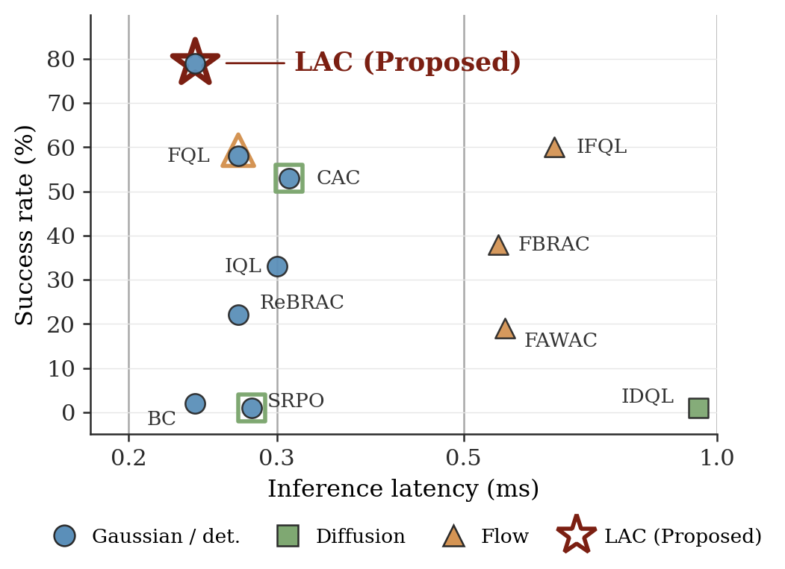

<div align="center">

# Simple Actors and Deep Critics for Scalable Reinforcement Learning

## [[website](https://YOUR-USERNAME.github.io/LAC)]      [[paper](https://doi.org/10.1145/3799682.3840726)]

</div>

<p align="center">
  <a href="https://YOUR-USERNAME.github.io/LAC">
    
  </a>
  <a href="https://YOUR-USERNAME.github.io/LAC">
    
  </a>
</p>

## Overview

**LAC** (Light Actor, Deep Critic) revisits where architectural capacity should go in offline actor–critic methods. The critic is used only to shape the policy gradient during training and is discarded afterwards, while the actor runs at every decision step — so capacity in the critic is paid once, but capacity in the actor is paid forever.

LAC pairs a *lightweight deterministic actor* (a single forward pass through a small MLP) with a *deep, well-trained critic* (32-layer ResMLP), matching the strongest diffusion- and flow-matching baselines on OGBench while cutting per-action inference latency by up to 4×.

Making the critic deep is non-trivial: naive deepening destabilizes value learning. LAC combines three ingredients, each addressing a distinct failure mode:

1. **Residual MLP backbone with LayerNorm** — restores gradient flow through many layers.
2. **n-step targets (n=4)** — swaps self-prediction for real reward, suppressing compounding bootstrap noise.
3. **Categorical cross-entropy over a bounded support** — prevents value-range drift and mid-training collapse.

Two actor sizes are provided: **LAC-S** ([256] × 2 MLP, 0.24 ms per action) and **LAC-L** ([512] × 4 MLP); both act in a single forward pass.

## Installation

```bash
pip install -r requirements.txt
```

## Datasets

We evaluate on [OGBench](https://github.com/seohongpark/ogbench), spanning long-horizon locomotion navigation (`antmaze`, `humanoidmaze`) and multi-step / combinatorial manipulation (`scene`, `puzzle`) — 7 environments and 40 tasks in total. Standard OGBench datasets are downloaded automatically on first use.

To use a custom (or large) OGBench dataset stored locally, pass `--ogbench_dataset_dir=[realpath/to/your/dataset/]`; the dataset chunks (`*.npz`) are cycled every `--dataset_replace_interval` steps to fit in memory.

## Reproducing paper results

All fixed hyperparameters (32-layer categorical ResMLP critic, n-step horizon 4, batch size 256, learning rate 3e-4, etc.) follow the defaults in `agents/lac.py` — see Table 5 of the paper. The two actor variants differ only in actor size: **LAC-S** uses a [256] × 2 MLP and **LAC-L** uses a [512] × 4 MLP. Example commands for all 7 environments are given below; replace `task1` with `task1`–`task5` to run each task.

```bash
# antmaze-large (LAC-S / LAC-L)
python main.py --run_group=reproduce --env_name=antmaze-large-navigate-singletask-task1-v0 \
    --agent.discount=0.995 --agent.alpha=10 --horizon_length=4 --agent.actor_hidden_dims="(256,256)"
python main.py --run_group=reproduce --env_name=antmaze-large-navigate-singletask-task1-v0 \
    --agent.discount=0.995 --agent.alpha=10 --horizon_length=4 --agent.actor_hidden_dims="(512,512,512,512)"

# antmaze-giant (LAC-S / LAC-L)
python main.py --run_group=reproduce --env_name=antmaze-giant-navigate-singletask-task1-v0 \
    --agent.discount=0.995 --agent.alpha=10 --horizon_length=4 --agent.actor_hidden_dims="(256,256)"
python main.py --run_group=reproduce --env_name=antmaze-giant-navigate-singletask-task1-v0 \
    --agent.discount=0.995 --agent.alpha=10 --horizon_length=4 --agent.actor_hidden_dims="(512,512,512,512)"

# humanoidmaze-medium (LAC-S / LAC-L)
python main.py --run_group=reproduce --env_name=humanoidmaze-medium-navigate-singletask-task1-v0 \
    --agent.discount=0.999 --agent.alpha=20 --horizon_length=4 --agent.actor_hidden_dims="(256,256)"
python main.py --run_group=reproduce --env_name=humanoidmaze-medium-navigate-singletask-task1-v0 \
    --agent.discount=0.999 --agent.alpha=20 --horizon_length=4 --agent.actor_hidden_dims="(512,512,512,512)"

# humanoidmaze-large (LAC-S / LAC-L)
python main.py --run_group=reproduce --env_name=humanoidmaze-large-navigate-singletask-task1-v0 \
    --agent.discount=0.999 --agent.alpha=20 --horizon_length=4 --agent.actor_hidden_dims="(256,256)"
python main.py --run_group=reproduce --env_name=humanoidmaze-large-navigate-singletask-task1-v0 \
    --agent.discount=0.999 --agent.alpha=20 --horizon_length=4 --agent.actor_hidden_dims="(512,512,512,512)"

# scene (LAC-S / LAC-L)
python main.py --run_group=reproduce --env_name=scene-play-singletask-task1-v0 \
    --agent.discount=0.99 --agent.alpha=300 --sparse=True --horizon_length=4 --agent.actor_hidden_dims="(256,256)"
python main.py --run_group=reproduce --env_name=scene-play-singletask-task1-v0 \
    --agent.discount=0.99 --agent.alpha=300 --sparse=True --horizon_length=4 --agent.actor_hidden_dims="(512,512,512,512)"

# puzzle-3x3 (LAC-S / LAC-L)
python main.py --run_group=reproduce --env_name=puzzle-3x3-play-singletask-task1-v0 \
    --agent.discount=0.995 --agent.alpha=1000 --sparse=True --horizon_length=4 --agent.actor_hidden_dims="(256,256)"
python main.py --run_group=reproduce --env_name=puzzle-3x3-play-singletask-task1-v0 \
    --agent.discount=0.995 --agent.alpha=1000 --sparse=True --horizon_length=4 --agent.actor_hidden_dims="(512,512,512,512)"

# puzzle-4x4 (LAC-S / LAC-L)
python main.py --run_group=reproduce --env_name=puzzle-4x4-play-singletask-task1-v0 \
    --agent.discount=0.995 --agent.alpha=1000 --sparse=True --horizon_length=4 --agent.actor_hidden_dims="(256,256)"
python main.py --run_group=reproduce --env_name=puzzle-4x4-play-singletask-task1-v0 \
    --agent.discount=0.995 --agent.alpha=1000 --sparse=True --horizon_length=4 --agent.actor_hidden_dims="(512,512,512,512)"
```

To sweep all 5 tasks of an environment automatically, pass the env name without a task id (e.g. `--env_name=humanoidmaze-large-navigate-singletask-v0`) and switch the entry point in `main.py` to `run_all_tasks_repeat`.

Useful flags:

- `--agent=agents/lac.py` — agent config (default).
- `--offline_steps` / `--online_steps` — offline pretraining and optional online fine-tuning steps.
- `--env_name=...-singletask-v0` (without a task id) with `run_all_tasks_repeat` in `main.py` sweeps `task1`–`task5` automatically.
- `--eval_episodes`, `--eval_interval`, `--save_interval` — evaluation and checkpointing.

Each run draws a random seed; results in the paper are averaged over multiple runs.

Training logs are written to wandb and per-run CSV files under `exp/`, and evaluation videos are saved under `exp/.../videos/`.

## Citation

```bibtex
@inproceedings{kang2026simple,
  title     = {Simple Actors and Deep Critics for Scalable Reinforcement Learning},
  author    = {Guhyeon Kang and Jaehwi Lee and Minhae Kwon},
  booktitle = {Proceedings of the 35th ACM International Conference on Information and Knowledge Management (CIKM '26)},
  year      = {2026},
  doi       = {10.1145/3799682.3840726}
}
```

## Acknowledgments

This codebase is built on top of [QC](https://github.com/ColinQiyangLi/qc) and [FQL](https://github.com/seohongpark/fql), and uses environments and datasets from [OGBench](https://github.com/seohongpark/ogbench).
